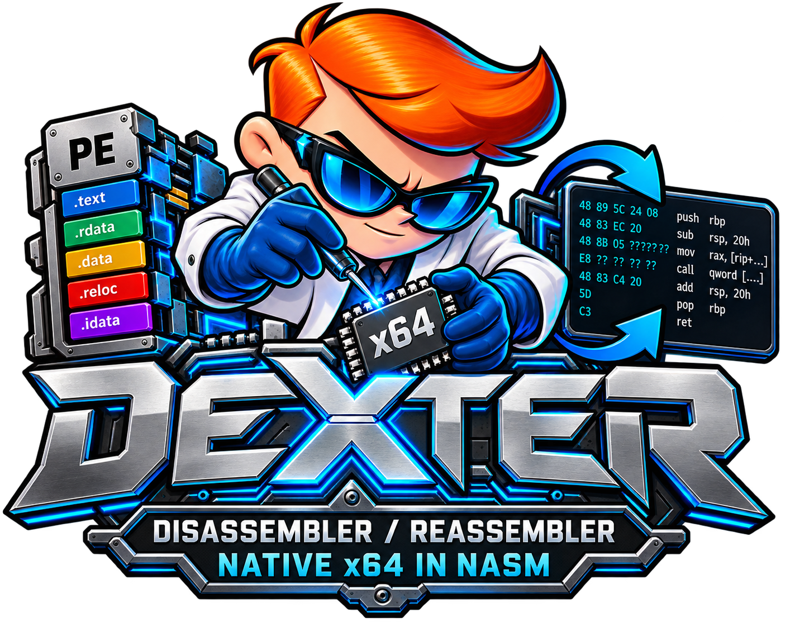

<p align="center">
  
</p>

<h1 align="center">Dexter</h1>

<p align="center">Desassemblador / Reassemblador PE nativo — x86-64 e x86 — NASM / Windows</p>

<p align="center">
  <a href="https://github.com/Spoiledpay/Dexter/actions/workflows/ci.yml"></a>
  <a href="LICENSE"></a>
</p>

> **Apoie o projeto.** O Dexter é desenvolvido de forma independente e
> continua gratuito e open source. Se ele ajuda no seu trabalho, considere
> apoiar o desenvolvimento contínuo pelo
> [GitHub Sponsors](https://github.com/sponsors/Spoiledpay). Qualquer
> contribuição é muito bem-vinda e ajuda a manter o tempo dedicado a testes,
> correções e novos recursos. Obrigado por fazer parte.

Ferramenta real, 100% NASM x86-64, sem CRT: lê um PE (PE32/PE32+), gera
`.asm` reassemblável e reconstrói o `.exe`. O modo `-m bin` produz
**round-trip byte-idêntico** (hello 2560 B, var64 91872 B, gcc 2 MB e
ld.lld 68 MB), com comportamento verificado.

Projeto: [github.com/Spoiledpay/Dexter](https://github.com/Spoiledpay/Dexter)

## O que a ferramenta faz hoje

### Desmontagem e reassemblagem

- **PE32+ (x64) e PE32 (x86)**: valida DOS/NT, seções, imports, exports,
  relocations, recursos e unwind info (`.pdata`/`.xdata`).
- **Decoder real x86-64/x86**: prefixos legacy, REX, ModRM/SIB, RIP-relative,
  tabelas 1/2/`0F38`/`0F3A`, grupos, x87, VEX/EVEX e 3DNow! (limites
  byte-exatos; VEX/EVEX/x87 semânticos ainda caem em `db` no `-native`).
- **`-m win64`**: gera `.asm`, monta com `nasm -f win64` e linka com
  `link.exe`; DataDirectories são remapeados por seção/offset.
- **`-m bin`**: gera um `.asm` autocontido e monta com `nasm -f bin`;
  caminho **byte-fiel** para PEs reais (inclusive gcc/ld.lld).
- **`-native`**: emite mnemônicos/labels reais quando possível
  (`mov`, `lea`, `[rel label]`, `call|jmp [rel __imp_X]`), com fallback `db`
  byte-exato; import table simbólica, `UNWIND_INFO` simbólico, `disp32`
  RIP-relative relocável, REX exato, `.bss` nobits e tail de `.data` com
  `vsize > raw`.
- **`-ast-dump`**: faz parse-back do `.asm` gerado e imprime o resumo
  `AST funcs=F blocks=B instrs=I succs=S db=D equ=E dir=R`.

### Análise (inspect-only, sem escrever `.asm`)

- `-overview` / `-json`: base, entrypoint, seções, imports/exports/relocs.
- `-func <VA>`: limites da função + calls/jumps.
- `-xrefs <VA>`: referências de código e dados (com `truncated` honesto).
- `-trace <VA>` / `-depth <N>`: cadeia de calls (DFS).
- `-rsrc`: inventário de recursos em 3 níveis (tipo/nome/idioma).
- `-snapshot <json>` / `-compare <b.exe>`: fingerprint FNV-1a e diff.
- `--doctor`: nasm/link/kernel32 + versão.

### Robustez

- Fallback `db` honesto para opcode não suportado; nunca erro falso.
- Validação de todos os campos do PE contra o tamanho do arquivo.
- `tests/fuzz_pe.py`: mutações determinísticas (MZ, `e_lfanew`, seções,
  imports, `.pdata`/`.xdata`, truncamento); o mutante nunca é executado.

## Uso rápido

```bat
build.bat

:: round-trip win64 (nasm + link)
out\dexter.exe tests\hello.exe -o tests\out\hello.asm -r -O tests\out\hello_rt.exe
tests\out\hello_rt.exe            &:: imprime "hi"

:: round-trip byte-idêntico (nasm -f bin)
out\dexter.exe tests\var64.exe -o tests\out\var64_bin.asm -m bin -r -O tests\out\var64_bin.exe
fc /b tests\var64.exe tests\out\var64_bin.exe

:: suíte completa
tests\run_tests.bat               &:: 426/426
```

### Exemplos de análise

```bat
out\dexter.exe app.exe -overview
out\dexter.exe app.exe -overview -json
out\dexter.exe app.exe -func 0x140001000
out\dexter.exe app.exe -xrefs 0x140001000
out\dexter.exe app.exe -trace 0x140001000 -depth 8
out\dexter.exe app.exe -rsrc
out\dexter.exe app.exe -snapshot app.json
out\dexter.exe app.exe -compare outro.exe
out\dexter.exe app.exe --doctor
```

### Saída e controle

| Flag | Efeito |
|---|---|
| `-o <arquivo.asm>` | Fonte NASM gerada (padrão: `<input>.asm`) |
| `-O <arquivo.exe>` | `.exe` reassemblado (implica `-r`) |
| `-m win64\|bin` | Caminho de rebuild (`win64` = nasm+link; `bin` = byte-fiel) |
| `-r` | Reassembla após gerar o `.asm` |
| `-L <linker>` / `-N <nasm>` | Caminhos explícitos do linker/nasm |
| `-s <seção>` | Só desassembla a seção indicada; demais saem como dados |
| `-start <RVA>` / `-end <RVA>` | Intervalo de código (hex) |
| `-hex` | Comentários `; @0xVA` / `; mne` |
| `-nop-pad` | `0x90`/`0xCC` como `nop`/`int3` reais |
| `-no-imports` / `-no-relocs` | Não processa imports/relocs (omite `.reloc`) |
| `-strings` | Runs ASCII em `db "..."`, 0; com `-native`, `dq label_` |
| `-native` / `-emit db\|native` | Emissor nativo opt-in (`-native` é alias) |
| `-ast-dump` | Resumo AST do `.asm` gerado |
| `-v` / `-vv` / `-q` | Verbose 1, verbose 2, silencioso |
| `-ver` / `-h` / `--help` | Versão / ajuda |

Códigos de retorno: `0` sucesso, `1` uso incorreto, `2` I/O, `3` PE inválido,
`4` opcode sem suporte ou recusa do `-native -r` com EH C++ do GCC,
`5` falha no rebuild. Referência completa: [docs/CLI.md](docs/CLI.md).

## Testes

- **Suíte rápida** (`tests\run_tests.bat`): **426/426 OK** em 1.2.417.
- **Suíte lenta** (`tests\run_slow.bat`): **7/7 OK** — ld.lld 68 MB
  byte-idêntico + gcc 2 MB byte-idêntico e compilando `hello.c`.
- **Fuzz** (`tests/fuzz_pe.py`): PE corrompido nunca deve crashar/hang;
  saídas aceitas `{0,1,2,3,5}`.
- **CI**: [`.github/workflows/ci.yml`](.github/workflows/ci.yml) roda em
  `windows-latest` com MSVC + NASM: build + suíte rápida. Os fixtures
  grandes `tests/gcc.exe` e `tests/ld.lld.exe` não são versionados e são
  pulados na CI (`DEXTER_SKIP_LARGE=1`); a suíte completa é local.

## Versão atual

**Dexter 1.2.417** (`-ver`). O patch é incrementado a cada `build.bat` via
`version.bin` + `tools\bump_version.ps1`.

## Limites conhecidos (honestos)

- PEs com **EH C++ do GCC/MinGW** (`__gxx_personality_*` /
  `__gcc_personality_*`) usam tabelas pcrel que o `link.exe` não relocaliza;
  `-native -r` no modo link é **recusado com exit 4** e recomenda `-m bin`
  (ADR-0004). O caminho fiel é `-m bin -native -r`.
- Índice simbólico de SIB-abs em x64 ainda é numérico (x32 já é simbólico).
- Operandos VEX/EVEX/x87 têm decodificação e limites byte-exatos, mas o
  emissor nativo ainda usa `db` para eles.
- `-no-imports` desativa a detecção de personalidade GCC (limite declarado).
- R-6.6 (IR otimizável + backend próprio, sem nasm) segue como evolução.

## Requisitos

- Windows x64.
- `nasm.exe` (em `C:\Nasm\` ou no `PATH`) e `link.exe` (MSVC).
- `kernel32.lib` do Windows SDK (o `build.bat` localiza; `SDKLIBDIR` faz
  override).

## Build

```bat
build.bat
```

Saída: `out\dexter.exe`. `clean.bat` remove `out\`/`obj\`.

## Estrutura

```text
build.bat  clean.bat  version.bin
include/         win64.inc dexter.inc pe.inc errors.inc macros.inc
src/cli io pe disasm gen util   módulos NASM, 1 responsabilidade cada
src/front/       lexer + parser + AST
src/back/        lift (DexIR) + codegen
docs/            CLI ARQUITETURA ROADMAP REVISAO CHANGELOG PE_NOTES ADRs
tests/           corpus + fixtures + run_tests.bat + run_slow.bat + fuzz
out/ obj/        artefatos de build (ignorados)
```

## Contribuição

Contribuições são bem-vindas: abra uma issue com um PE de exemplo (sem dados
sensíveis), descreva o comportamento esperado e, se possível, inclua o
`.asm`/log gerado. Antes de alterar código, rode `build.bat` e
`tests\run_tests.bat`.

## Licença

Distribuído sob a **licença MIT**. Veja [LICENSE](LICENSE).

Copyright (c) 2026 Labsobjects.org | Developer.
